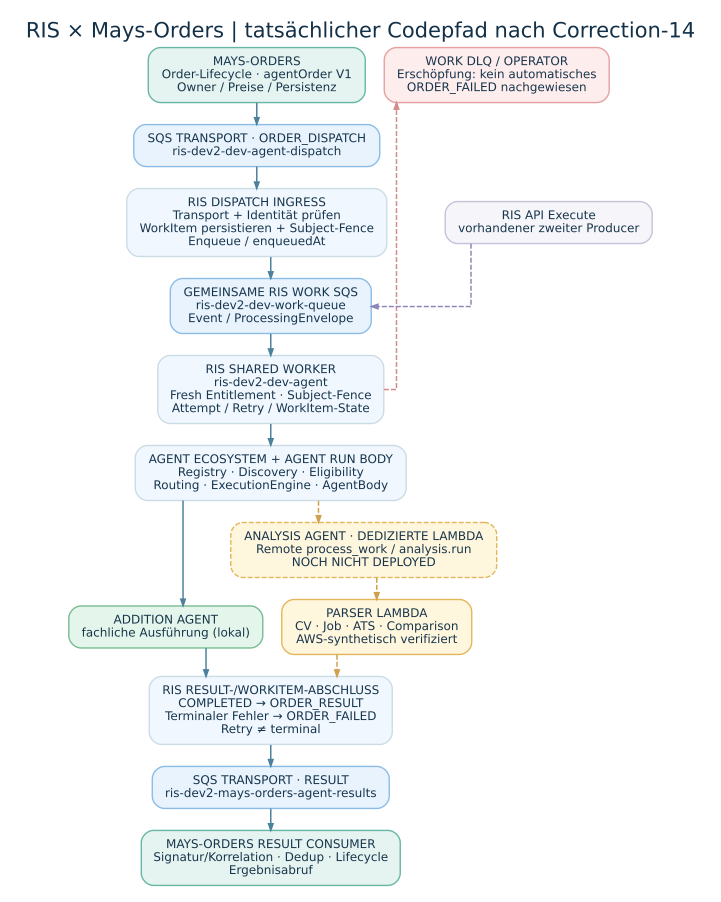
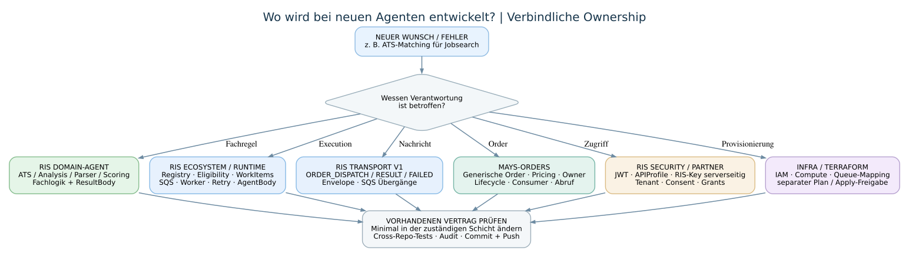

> **VERBINDLICHER STAND.** Diese Baseline ersetzt die vorherige **Integration-13-Referenz** für neue Entwicklungsaufträge. Sie dokumentiert den **gemeldeten und im RIS-Report dokumentierten Code-/Teststand nach `RIS-ANALYSIS-ECOSYSTEM-CORRECTION-14`** auf dem Feature-Branch, **nicht** einen bereits angewendeten AWS-Stand. **Kein Terraform Apply, kein Main-Merge, keine Produktionsfreigabe, keine echten Bewerberdaten.** Der ältere Integration-13-Snapshot bleibt als historische Quelle erhalten.

> **Leitsatz.** **Mays-Orders verwaltet Orders. RIS Transport transportiert die bestehenden Verträge. RIS Ecosystem/Runtime besitzt WorkItems, gemeinsame SQS, Worker und Agent-Ausführung. Fachagenten liefern ausschließlich fachliche Ergebnisse.** Fehler werden **im Modul ihres fachlichen Eigentümers** korrigiert – nicht dort, wo sie zuerst auffallen.

**Navigation:** 1 Status und Quellen · 2 Architektur · 3 Modul-Ownership · 4 SQS/Worker · 5 Technisches Modulregister · 6 Transport und Zustände · 7 Sicherheit · 8 Entwicklungsregeln · 9 Beispiel ATS/Jobsearch · 10 Offene Gates · 11 Release-Daten · 12 Referenz-Checkliste.

# 1. Geltungsbereich, Evidenz und Änderungsstand

Diese Referenz verwendet folgende Evidenzarten:

- **ARCHITEKTUR:** `reference/RIS_AGENTEN_KONSOLIDIERUNG_2026-11-13.pdf`, besonders S. 2–3 (gemeinsame Queue), S. 5–7 (Autorisierung/States), S. 9–10 (Regression/Arbeitsregeln).
- **CODE-/TEST-REPORT:** `docs/reports/RIS-ANALYSIS-ECOSYSTEM-CORRECTION-14.md` am RIS-Commit `6440e53` (auf Basis von Integration-13 `c7fa5eb`). Bericht: **349 passed, 9 skipped**, Tests mit synthetischen Daten.
- **CODE-UMSETZUNG laut Bericht:** `f639611` (Dispatch→Work-Queue, terminales ORDER_FAILED, reduzierte Analyse-IAM-Rechte), `6440e53` (Bericht/Manifest/Auditlog), beide gepusht.
- **AWS-STAND:** Vorheriger `ris-dev2`-State Serial **67**; neue Analysis-Lambda und Änderungen an Ingress/Worker **noch nicht angewendet**. Frühere AWS-Parser-Verifikation und Code-Simulation sind **kein** Full-Ecosystem-Live-Test.

| Prüffrage | Stand nach Correction-14 | Aussagegrenze |
|:--|:--|:--|
| Mays-Orders → Dispatch-SQS → RIS-Ingress | Vorhanden und beschrieben | Bestehende Infrastruktur; keine neue Order-Implementierung |
| RIS-Ingress → persistiertes WorkItem → gemeinsame Work-SQS | **In Feature-Code implementiert und synthetisch getestet** | **Noch nicht in `ris-dev2` angewendet** |
| Work-SQS → gemeinsamer Worker → Agent Ecosystem | Vorhandener Worker-Pfad, erweitert für vorpersistierte `QUEUED`-WorkItems | Current AWS-Wiring für neuen Pfad erst nach Apply |
| Addition Agent | Fachausführung via bestehender Registry/AgentBody | Synthetische E2E-Regression nach Correction-14 |
| Analysis Agent | Remote-Adapter + dedizierte Lambda vorbereitet | **Analysis-Lambda nicht deployed** |
| ORDER_RESULT | Bestehender Ergebnisvertrag, stabiler Message-/Idempotency-Key | At-least-once mit deduplizierter Verarbeitung |
| ORDER_FAILED bei terminaler Runtime-Ablehnung | **Im Code ergänzt und synthetisch getestet** | **DLQ-Erschöpfung ohne Consumer bleibt offen** |
| Legal / Activation / Consent | DRAFT / nicht freigegeben | Kein echter Nutzerverkehr |

**Verwechslungswarnung:** Ein grüner Test und ein gültiger Terraform-Plan sind keine Live-Freigabe. Der Code-Stand ist ein *Deployment-Kandidat*.

# 2. Verbindliche Gesamtarchitektur

## 2.1 Der nach Correction-14 implementierte logische Ablauf

1. **Mays-Orders** verwaltet die generische Order und legt den fachlichen `agentOrder V1` verschachtelt darin ab.
2. **Mays-Orders Transport** sendet `ORDER_DISPATCH` über die bestehende Dispatch-SQS `ris-dev2-dev-agent-dispatch`.
3. **RIS Dispatch Ingress** prüft das Transport-V1-Envelope, `execution.workId` und den serverseitig aufgelösten `VerifiedContext`. Es bildet ein kanonisches WorkItem, persistiert mit bestehender Subject-Fence-Transaktion und sendet eine Nachricht in die **bestehende** Work-SQS.
4. **Gemeinsame RIS Work Queue** `ris-dev2-dev-work-queue`: Aktivierungs-/Processing-Nachricht, **keine** agentenbezogene Queue und **keine** Autorisierung durch Nachrichtentext.
5. **RIS Shared Worker** `ris-dev2-dev-agent`: übernimmt die vorpersistierte `QUEUED`-Zeile durch konditionalen Claim, prüft Berechtigung/Fence erneut, verwaltet Attempt, Retry und WorkItem-State.
6. **RIS Agent Ecosystem/Agent Run Body**: Registry, Discovery, Eligibility, Routing, ExecutionEngine und AgentBody wählen den fachlichen Handler.
7. **Fachagent**: Addition-Agent lokal; Analysis-Agent als dedizierte Remote-Lambda *geplant* und nur für `analysis.run`, mit Parser-Lambda als Ausführungskomponente. Der Agent darf keine Order verwalten.
8. **Runtime/Result Transport** persistiert WorkItem-Completion und erzeugt für ordergebundene WorkItems `ORDER_RESULT` oder bei **terminaler** Ablehnung `ORDER_FAILED` mit deterministischer Message-ID.
9. **Mays-Orders Result Consumer** prüft Envelope/Signatur/Korrelation, dedupliziert und pflegt den **Order**-Lifecycle. Der RIS-Agent besitzt keine Order-State-Machine.

Ein zweiter vorhandener Producer, **RIS API Execute**, sendet ebenfalls in die gemeinsame Work-SQS. Der API- und Order-Dispatch-Eingang benutzen damit im neuen Feature-Code denselben Worker-Pfad.

{width=15.6cm}

*Abb. 1 – Correction-14. Durchgezogene Pfeile: implementierter logischer Pfad; gestrichelte Analysis-Pfade: vorbereitet, aber noch nicht deployed. DLQ-Erschöpfung bleibt gesondert offen.*

## 2.2 Architekturverbote – für alle neuen Agenten verbindlich

- **Keine SQS-Queue pro Fachagent.** Dispatch-, Work- und Result-Transport existieren bereits.
- Keine zweite WorkItem-/Attempt-/Retry-/DLQ-/Idempotenzplattform.
- Keine direkte Mays-Orders-zu-konkretem-Agent-Kopplung.
- Keine zweite Mays-Orders-State-Machine in RIS.
- Keine fachliche Agent-Ausführung im `dispatch_ingress`.
- Keine Verarbeitung allein aufgrund behaupteter Tenant-/Partner-/Agent-Metadaten.
- Keine neue `ORDER_*`-Envelope-Familie, solange Transport V1 den Vertrag abdeckt.
- Keine stille Terraform-/AWS-/Main-/Production-Mutation im Rahmen eines Agentenfeatures.

# 3. Verbindliche Ownership-Matrix

| Schicht | Eigentümer / Verantwortung | Explizite Nicht-Verantwortung |
|:--|:--|:--|
| **Mays-Orders** | Generische Order, Owner, Validierung, Preis/Billing, Lifecycle, Persistenz, Result Consumer, Ergebnisabruf | Agentenregistrierung, Fachanalyse, RIS-WorkItem-Retry |
| **RIS Agent Order V1** | In Order verschachtelter fachlicher Vertrag: `target`, `input`, `metadata`, `processing`, `resultContract` | Zweite generische Order, eigener Order-Lifecycle |
| **RIS Transport V1** | `ORDER_DISPATCH`, `ORDER_RESULT`, `ORDER_FAILED`; Envelope/Signatur/Korrelation und SQS-Grenzen | Agent-Fachlogik, neue konkurrierende Transportverträge |
| **RIS Dispatch Ingress** | Envelope-Validierung, trusted `contextRef`, kanonisches WorkItem, Subject-Fence-Persistenz, Work-SQS-Enqueue | Agent-Ausführung, Preis, Order-State, Ergebnisberechnung |
| **RIS Worker / Runtime** | `QUEUED → RUNNING`-Claim, Attempts, idempotente Ausführung, Retry/DLQ, WorkItem-Completion, terminale Failure-Erkennung | Order-Lifecycle oder Domain-Scoring |
| **RIS Agent Ecosystem** | Catalog, Registry, Discovery, Eligibility, Entitlement, Routing, AgentBody, AgentInvoker/Adapter | Eigene Order-Stati, Endkundenabrechnung |
| **RIS Domain-Agenten** | `process_work` und fachliche Ergebnisse (Addition, ATS, Analysis, CV-/Jobparser) | SQS-Dispatch, WorkItems-Ownership, Transport-Result-Sender, Billing |
| **RIS Partner-/Privacy-Boundary** | JWT, Issuer/Audience, PartnerApplication, RIS-Key/APIProfile, Tenant/Owner, Grants, Consent, Subject-Fence | `metadata` als Autorisierung oder browserseitige RIS-Keys |
| **Infrastructure/Terraform** | IAM, Lambda, Queue-Mapping und umgebungsspezifische Freigaben | Fachlichen Ownership-Vertrag ohne Architekturentscheidung ändern |

**Merksatz für Code-Reviews:** Eine fachliche Ausnahme in einem ATS-Agenten ist Agentenarbeit; ein fehlerhafter SQS-Replay ist **Ecosystem-Arbeit**; ein fehlerhafter Auftragspreis ist **Mays-Orders-Arbeit**.

# 4. SQS-Topologie und Kontrollpunkte (`ris-dev2`)

| Queue / DLQ | Producer | Consumer / Rolle |
|:--|:--|:--|
| `ris-dev2-dev-agent-dispatch` | Mays-Orders `ORDER_DISPATCH` | RIS `dispatch_ingress`, Event Source Mapping |
| `ris-dev2-dev-agent-dispatch-dlq` | Redrive der Dispatch-SQS | Operator / Incident-Prozess |
| `ris-dev2-dev-work-queue` | **RIS Ingress (Correction-14)** + RIS API Execute | Shared Worker `ris-dev2-dev-agent` |
| `ris-dev2-dev-dlq` | Redrive der Work-SQS | Operator / Incident-Prozess |
| `ris-dev2-mays-orders-agent-results` | Bestehender RIS Result-Sender | Mays-Orders Result Consumer |
| `ris-dev2-mays-orders-agent-results-dlq` | Redrive der Result-SQS | Mays-Orders / Operator |

**Alle sechs Ressourcen sind bereits vorhanden.** Correction-14 plant **keine** neue Queue. Zusätzliche Domain-Queues (`cv`, `ats`, `match`) sind nicht Teil des beschriebenen Analysis-Order-Pfads.

## 4.1 WorkItem vor Enqueue und Crash-Recovery

- `dispatch_ingress` persistiert über die vorhandene Subject-Fence-Transaktion, danach `SendMessage` an die bestehende Work-SQS, danach `enqueuedAt`.
- Duplikat mit `enqueuedAt`: kein erneutes Send; terminales Duplikat: kein Send.
- Persist erfolgreich, Send gescheitert: WorkItem bleibt `QUEUED` ohne Marker; SQS-Partial-Batch-Failure führt zu erneutem Dispatch-Versuch.
- Crash zwischen Persist und Send: Retry kann erneut senden; der Worker dedupliziert über `workId` und konditionalen State-Claim.
- Worker nimmt vorpersistierte `QUEUED`-Zeile konditional nach `RUNNING`; konkurrierende Zustellung verliert den Claim und führt keinen zweiten fachlichen Run aus.
- `FAILED` folgt vorhandener Attempt-/Retry-Semantik; temporäre Fehler werden erneut zugestellt, bis Redrive/DLQ greift.

**Präzision:** DynamoDB+SQS bieten keine transaktionsübergreifende Exactly-once-Zustellung. Der dokumentierte Vertrag lautet *at-least-once* mit idempotenter Ausführung und deduplizierten Ergebnissen. Ein fehlendes `enqueuedAt` ist ein Recovery-Signal, kein Beweis, dass eine Nachricht nie gesendet wurde.

# 5. Technisches Modulregister und Codezuständigkeiten

## 5.1 Mays-Orders – bestehende Order-Ebene

| Verzeichnisse / Dateien (Referenz) | Eigentum |
|:--|:--|
| `lambda/src/order_service.py`, `validation.py`, `state_machine.py` | Erstellen, validieren, bepreisen, persistieren, Order-State-Machine |
| `mays_orders/lambda/src/dispatch.py` (im RIS-Installer gepinnt) | `ORDER_DISPATCH` gemäß Transport V1 |
| `result_consumer.py`, `result_envelope.py` | HMAC/Correlation/Idempotenz und `ORDER_RESULT`/`ORDER_FAILED`-Consume |
| `agentOrder V1` als verschachtelte Order-Struktur | Fachauftrag, ohne eigene generische Order |

**Keine Mays-Orders-Codeänderungen aus Correction-14.** Historisch dokumentierter Mays-Orders-Code-Pin `9627eb2` ist ein Review-Bezug, nicht ein Nachweis über alle neuesten Mays-Orders-Releases.

## 5.2 RIS Transport + Ingress

| RIS-Datei / Baustein | Eigentum |
|:--|:--|
| `agents/transport/order_transport.py` | Transport-V1-Envelope, `VerifiedContext`, `dispatch_to_work_item`, `result_from_work_item` |
| `lambda/dispatch_ingress.py` | Dispatch-SQS lesen, Trust/Envelope prüfen, WorkItem mit Fence persistieren, vorhandene Work-SQS enqueuen |
| `agents/transport/order_result_sender.py` | Vorhandene Result-SQS-Zustellung und Signatur; **kein** Domain-Agent-Sender |
| `terraform/modules/agent_transport/` | Ingress Lambda, Transport-Ressourcen/IAM; Korrekturplan erweitert Ingress SendMessage-Berechtigung |

`dispatch_ingress` führt **nach Correction-14 keine fachliche Agent-Ausführung mehr aus**. Änderungen des Enqueue-/Redrive-Vertrags gehören hierher, nicht zu ATS oder Analysis.

## 5.3 RIS Runtime, Worker und Ecosystem

| RIS-Datei / Baustein | Eigentum |
|:--|:--|
| `agents/runtime/pipeline.py` | `process_record`, WorkItem-Claim, Attempts, Status, terminales `ORDER_FAILED`, `ORDER_RESULT`-Weitergabe |
| `lambda/handler.py` | Shared Worker / API-Execute-Wiring; Work-SQS-Consumer-Pfad |
| `agents/ecosystem/registry.py`, `discovery.py`, `eligibility.py`, `routing.py` | Agent Descriptor, Discovery, Eligibility, Routing/ExecutionEngine |
| `agents/ecosystem/worker_authorization.py`, `agents/runtime/subject_fence.py` | Fresh Entitlement Recheck, Subject-Fence, fail-closed |
| `agents/agent_body/` | Einheitlicher Agent Run Body / fachliche Handler-Schnittstelle |
| `agents/runtime/remote_agent.py` | Generischer Remote-Lambda-Adapter: vorhandener `process_work`-Vertrag, kein eigener WorkItem-/Result-Lifecycle |

**Konsolidierungsregel:** Ein generischer Fehler hier wird als kleines RIS-Ecosystem-/Runtime-Arbeitspaket behoben und gegen den Additionsagenten regressionsgetestet. Er wird **nicht** als ATS-/Analysis-Sonderlogik kopiert.

## 5.4 Fachagenten – Addition, Analysis, ATS, Jobsearch

| Fachmodul | Fachverantwortung / Status |
|:--|:--|
| `agents/addition_agent/` | Referenz für einen einfachen Agenten über gemeinsame Registry/AgentBody, lokale Ausführung |
| `agents/analysis_agent/` | `analysis.run`, fachliche CV-/Job-/ATS-/Comparison-Verarbeitung; WorkType-Gate `_is_analysis_work` |
| `agents/analysis/` | Orchestrator, CV-Resolver, JobStore, Parser-Adapter, Ergebnisverträge; keine Order-Mutation |
| `lambda/analysis_runner.py` | Dedizierte Remote-Analyse im `executionMode=agent` ohne WorkItem-/Order-Lifecycle; **Deployment ausstehend** |
| `ris-dev2-dev-analysis-parser` | Bereits synthetisch AWS-verifizierte Node-Parser-Lambda; getrennt von Analysis-Compute |
| `agents/ats_agent/` | ATS-Domain-Logik, Scoring und Parsing/Matching; genaue Capabilities stets aus dem vorhandenen Contract übernehmen |
| `agents/jobsearch_agent/` | Jobsearch-Domain-Funktionen; UI/Browser-Persistenz im Jobsearch-Projekt statt in Mays-Orders implementieren |

**Analysis Least Privilege nach Correction-14:** Remote-Analysis-Lambda benötigt in der neu geplanten Datenpolicy nur PartnerProfiles-Leserechte; **keine** WorkItems-Schreibrechte, **keine** Entitlements-Leserechte und **keine** Order-/Result-SQS-Zustellrechte. WorkItems, Entitlements und Result-Sender bleiben in der gemeinsamen Runtime. Existing Parser-Invoke, Dokumenten-/Job-S3-Berechtigungen und Logs sind separat zu prüfen.

# 6. Contracts, Zustandsräume und Ergebniswege

## 6.1 Datenschnittstellen

| Contract | Produzent / Consumer | Kernpflicht |
|:--|:--|:--|
| **Generische Order** | Mays-Orders | Owner, Lifecycle, Preise und Persistenz |
| **RIS agentOrder V1** | Innerhalb der Mays-Order | `target`, `input`, `metadata`, `processing`, `resultContract` |
| **ORDER_DISPATCH** | Mays-Orders → RIS Dispatch-SQS | Verifizierbares Envelope, vorgebundene `execution.workId` und `contextRef` |
| **WorkItem / ProcessingEnvelope** | RIS Ingress/API → gemeinsame Work-SQS → Worker | Persistierte Identität, Attempt, Work-Type, Korrelationskontext |
| **AgentBody `process_work`** | Worker/Ecosystem → Domain-Agent | Fachausführung ohne Order-State-Mutation |
| **ORDER_RESULT** | RIS Result-Sender → Mays-Orders Consumer | Erfolg und stabiler `msg_<workId>_order_result` / deduplizierbare Idempotenz |
| **ORDER_FAILED** | RIS Result-Sender → Mays-Orders Consumer | Terminale Failure-Semantik, stabiler `msg_<workId>_order_failed` |

## 6.2 Wann ORDER_FAILED erzeugt wird

**Im Feature-Code ergänzt** für ordergebundene WorkItems bei: fehlendem Identitätsbinding, terminalem Entitlement-Denial oder permanentem Agent-`ValidationError`. Es wird **nicht** für transiente/retryfähige Fehler, nicht für Non-Order-WorkItems und **nicht automatisch bei SQS-DLQ-Erschöpfung** erzeugt. Fehlernachricht enthält nur `{message, type}`, keine CV-/Job-Payload. Mays-Orders akzeptiert laut Cross-Repo-Contract-Tests beide Result-Typen und dedupliziert.

**Noch offen:** Nach Erschöpfung der SQS-Redrives besitzt die Work-DLQ keinen Consumer für den abschließenden Failure-Transport. Das ist eine **separate RIS-Ecosystem-/Transport-Entscheidung**, kein Anlass für einen agenteneigenen DLQ-Consumer.

## 6.3 Vier getrennte Zustandsräume

1. **Order-State** – allein Mays-Orders.
2. **WorkItem / Attempt / Retry / DLQ** – RIS Runtime/Worker.
3. **Agent-Katalog/Registry-Status** – RIS Catalog/Ecosystem (nur ACTIVE ist ausführbar; ACTIVE ist noch kein Grant).
4. **Partner/Identity/Consent/Entitlement** – RIS Partner-/Security-Boundary; Recheck beim Worker und bei Redelivery.

# 7. Identität, Entitlements und Datenschutz

- Verifizierte Identität: JWT, Issuer/Audience, PartnerApplication, APIProfile und serverseitiges RIS-Credential; ein `contextRef` wird gegen vertrauenswürdige Stores aufgelöst.
- `metadata` sind **keine Autorisierung**. Ein SQS-Envelope, ein `agentId`-Feld oder eine frei gesetzte `tenantId` gewährt keine Rechte.
- Catalog ACTIVE ∩ gültige Grants/Entitlements ∩ Capability ∩ Consent ∩ Tenant/Owner ist der relevante Entscheidungskontext; vor Ausführung frisch prüfen.
- WorkItem-Subject-Fence verhindert unzulässige Wiederbelebung; Cross-Tenant-/CV-Ownership-Bindung bleibt fail-closed.
- RIS-Key ausschließlich serverseitig verwenden; keine JWTs, Keys, CV-/Job-Bytes oder PII in Report/CloudWatch-Logs.
- Analysis-Notice `analysis-processing` bleibt **DRAFT**, Entitlements **PENDING_APPROVAL**, Catalog **ABSENT**, Activation **false**. Es existiert keine Freigabe für echte Bewerberdaten oder öffentliches Agent-Serving.
- Ein synthetisches Test-Env mit vorübergehenden Freigaben ist **ein separater Operator-Gate** und nicht Teil des 4/3/0-Plans.

# 8. Verbindliche Entwicklungsregeln für neue Agenten

{width=15.6cm}

*Abb. 2 – Routing von Änderungswünschen: Fachlogik zum Domain-Agent; Infrastruktur und Querschnittsverträge in ihre vorhandenen Module.*

| Gemeldetes Problem / Feature | Richtiger Modul-Owner | Nicht dort ändern |
|:--|:--|:--|
| ATS-Parsing, Match-Score, LLM-Auswertung, fachlicher ATS-ResultBody | RIS ATS-Agent / bestehende Parserdomäne | Mays-Orders, Transport-Ingress |
| Neuer Analysis-Algorithmus oder CV-/Jobparser | RIS Analysis/Parser-Agent | SQS-Worker, Order-Service |
| Agent nicht gefunden, falsches Target, fehlende Capability | RIS Registry/Discovery/Eligibility | Mays-Orders-Preislogik |
| Enqueue, Worker-Zuweisung, Retry, DLQ, Attempt, Duplikat | RIS Ecosystem/Runtime/Ingress | Domain-Agent |
| Result-Envelope, Signatur, ORDER_FAILED oder Zustellung | RIS Transport/Runtime; Consumer-Contract mit Mays-Orders verifizieren | Analysis-Agent als Sender |
| Auftragspreis, Order-Validierung, Order-Owner, Order-Status, Rechnung, Ergebnisabruf | Mays-Orders | RIS Domain-Agent |
| Partner-/APIProfile-Bindung, Consent, RIS-Key, Grant | RIS Partner-/Security-Boundary | Browser-Metadaten, Fachagent |
| Neue IAM-Permission, Lambda-Bundle, Queue-Mapping | RIS-/Mays-Infra-Owner **nach** fachlicher Zuordnung | Ungefragter Terraform Apply |

**Standardablauf für Modi und andere Coding-Agenten:**

1. **Owner bestimmen:** Welches Modul ist fachlich verantwortlich? Bereits vorhandene Modul- und Contract-Referenz lesen.
2. **Schnittstellen prüfen:** Generische Order / agentOrder V1 / Transport V1 / WorkItem / AgentBody / ResultContract / verifizierte Partner-Identität. Keine Neuimplementierung, wenn der Vertrag existiert.
3. **Fachagent minimal ändern:** Für ATS beispielsweise Parser/Matching; keine Queue, keine Order-State-Machine, keine eigene Authentisierung.
4. **Querschnittsfehler separieren:** Wenn Enqueue, Worker, Registry, Consent oder Result-Sender nicht ausreichen: eigenes RIS-Ecosystem-/Security-Arbeitspaket mit Regression, nicht versteckte Agent-Sonderlogik.
5. **Mays-Orders-Anforderung separieren:** Preise, Owner, Lifecycle oder Consumer gehören in einen **eigenen Mays-Orders-Auftrag**; nicht im RIS-Feature-Branch „mitreparieren“.
6. **Verträge und Negativpfade testen:** Addition als Referenz, betroffener Agent, SQS-Retry/Redelivery/DLQ, Entitlement-Revoke, Cross-Tenant, Subject-Fence und Result-Consumer.
7. **Audit/Git:** `AGENTS.md` + `docs/AI_AUDITLOG.md` vor jedem Schritt; nach jedem abgeschlossenen Schritt Tests → Auditlog → Commit → Push Feature-Branch.
8. **Freigaben trennen:** Read-only Terraform-Plan und Guard zuerst; kein Main-Merge, keine Produktion, kein Terraform Apply ohne neue ausdrückliche Operator-Freigabe.

# 9. Beispiel: ATS-Agent für Jobsearch entwickeln

**Beispielauftrag:** „CV und Stellenanzeige über RIS ATS vergleichen; Jobsearch bekommt versioniertes Matching-Ergebnis.“

| Schritt | Zuständigkeit / Vertrag |
|:--|:--|
| Jobsearch UI / BFF | Nutzerführung, zulässiger Request, serverseitige Schlüsselverwendung; **keine** SQS-/Orders-Implementierung im Browser |
| Mays-Orders **nur bei kostenpflichtiger Order** | Generische Order, Preis/Billing, verschachteltes `agentOrder V1`, Lifecycle |
| Transport | Bestehendes `ORDER_DISPATCH` oder bereits freigegebener RIS Execute-Contract; keine neue Queue |
| RIS Ingress / Work Queue | Verifizierter Kontext, Persistenz, Enqueue; bestehender Worker verarbeitet |
| RIS Ecosystem | Agent-Registry, Eligibility/Entitlement, Owner-/Tenant-Recheck, AgentBody-Aufruf |
| RIS ATS-Agent | CV-/Job-Parsing, ATS-Matching, Scores und versioniertes Ergebnis – **fachliche Logik** |
| RIS Runtime / Transport | WorkItem-Completion, `ORDER_RESULT`/`ORDER_FAILED` für ordergebundene Arbeit |
| Mays-Orders Result Consumer | Order-Ergebnis akzeptieren und Order-Lifecycle aktualisieren, falls eine Order verwendet wird |
| Jobsearch UI / BFF | Ergebnis über den dafür vorgesehenen, autorisierten API-/Order-Abruf darstellen |

**Wichtig:** Es ist **nicht** jede interne oder unentgeltliche ATS-Ausführung automatisch eine Mays-Order. Für jeden Auftrag ist zu definieren, ob ein abrechenbarer `agentOrder`-Pfad oder der freigegebene direkte RIS-API-Execute-Pfad gilt; beide sollen den gemeinsamen RIS Worker wiederverwenden.

## 9.1 Minimaler Agenten-Steckbrief (vor dem ersten Commit)

| Feld | Vorlage |
|:--|:--|
| Agent-ID und Capability | Bestehenden Catalog-/Registry-Wert einsetzen; **nicht erraten** |
| Domain-/Contract-Version | ATS/Analysis ResultBody und `resultContract` pinnen |
| Eingang | RIS API Execute oder Mays-Orders `agentOrder V1`, ausdrücklich angeben |
| Identity | verifizierter User/Tenant/APIProfile/Issuer, serverseitig gebunden |
| Ausführung | Gemeinsame Work-SQS → Worker → AgentBody → `process_work` |
| Fachberechtigungen | Entitlement/Consent/Recheck in RIS; Domain-Checks nur ergänzend |
| Ergebnis/Fehler | Bestehender WorkItem-/Transport-Vertrag; keine eigene Ergebnis-SQS |
| Testmatrix | Addition-Regression + fachliche Tests + Redelivery/Revocation/Subject-Fence |
| Deployment | Eigenständiger Read-only-Plan, Hashes, State/Lineage/Guard, ausdrückliche Freigabe |

# 10. Offene Punkte und Abnahmegrenzen

| Gate | Stand | Owner / nächste Entscheidung |
|:--|:--|:--|
| K1 Dispatch→Work-Queue | **Code + synthetische Tests abgeschlossen** | RIS Ecosystem/Infra: noch nicht angewendet; AWS-Canary erforderlich |
| K2 Terminales ORDER_FAILED | **Code + synthetische Tests abgeschlossen** | RIS Runtime/Transport: echter AWS-Canary erforderlich |
| K3 DLQ-Erschöpfung | **Offen**: kein DLQ-Consumer sendet ORDER_FAILED | RIS Ecosystem/Transport: eigenständige Recovery-/Failure-Entscheidung, kein Agenten-Feature |
| K4 Analysis-Lambda | Code/Bundles und Terraform-Plan vorbereitet | RIS Infra: neuer Apply-Operator-Gate erforderlich |
| K5 Synthetische Analysis-Env | Deny-by-default; nur negative Tests ohne Sonderfreigabe | RIS Security/Privacy: separat entscheiden, kein automatisches Consent-Grant |
| K6 Legal/Entitlement/Catalog/Activation | DRAFT / PENDING / ABSENT / false | RIS Product/Privacy: eigenständige formelle Freigabe für echte Nutzer |
| K7 Full AWS Ecosystem Canary | Nicht erfolgt | Synthetisches Ende-zu-Ende-Live-Gate nach autorisiertem Apply |

**Klarstellung:** `READY FOR FULL ECOSYSTEM CANARY REVIEW` bedeutet **prüfbar und bereit zur Deployment-Entscheidung**, nicht `FULL AWS E2E VERIFIED` oder `PRODUCTION READY`.

# 11. Release- und Terraform-Snapshot: **nicht freigegeben**

| Eigenschaft | Wert aus Correction-14 |
|:--|:--|
| RIS Feature-Code-Commit | `f639611` |
| Report-/Audit-Commit | `6440e53` |
| Testbericht | **349 passed, 9 skipped** (24 fokussierte Dateien) |
| Account / Region | `262370457690` / `eu-central-1` |
| Terraform Workspace | `ris-dev2` |
| State vor Apply | Serial **67**, Lineage `a0bd361d-5cd1-a207-a8c0-e6888f0be082` |
| Plan-Zusammenfassung | **4 Adds / 3 Changes / 0 Destroys / 0 Replacements** |
| Plan SHA-256 | `4a0a02f5a9bd7f16a1295d046798c314a9faac8425e2864d02ec442ed304d033` |
| Plan-JSON SHA-256 | `e13e7631aa08ed5cf13eb3867060d055076c405eaaeb326d618227e24c1df7a2` |
| Worker-Bundle SHA-256 | `0d49527e3a74c7e84d0a7ac9c6e0fcfa3673ae510a17ad075848f2e30fc61b37` |
| Analysis-Bundle SHA-256 | `83eef8e691e15ada27bd9afa109b551c00dae766fe0b8a57c4ce1fc637df1184` |
| Guard | `NO_SHARED_DESTROY` |
| AWS Apply / Main-Merge / Production | **NICHT ERFOLGT / NICHT FREIGEGEBEN** |

**Vier Adds:** Analysis-Lambda, reduzierte Analysis-Datenpolicy, zwei resource-based Invoke-Permissions.

**Drei In-place-Changes:** Ingress-Rollenpolicy (SendToWorkQueue), Ingress-Lambda (Code/Env), Worker-Lambda (Code/Env). Keine Queue-/Tabelle-/Secret-/Cognito-/CloudFront-/DNS-Änderungen laut gespeichertem Read-only-Plan.

**Freigabe:** Alle früheren 2/0/0- und 4/2/0-Pläne gelten als zurückgestellt. Auch der hier dokumentierte **4/3/0-Plan ist nicht freigegeben**. Unmittelbar vor einem möglichen Apply müssen Account, State/Lineage, Plan-/Artefakt-Hashes, Manifest und Guard erneut geprüft und die Freigabe explizit erteilt werden. Eine separate synthetische Env-Freigabe ist davon unabhängig.

# 12. Wiederverwendungs- und Quellenhinweise

## 12.1 Fünf Fragen vor jedem neuen Agentenfeature

1. **Ist es Fachlogik?** Dann in den ATS-/Analysis-/Jobsearch-Agent, unter dem bestehenden `process_work`-Vertrag.
2. **Ist es WorkItem, SQS, Routing, Retry, DLQ oder Result-Transport?** Dann RIS Ecosystem/Transport, mit Addition-Regression.
3. **Ist es Preis, Owner, Order, Lifecycle oder Ergebnisabruf?** Dann Mays-Orders, eigenes Cross-Repo-Arbeitspaket.
4. **Ist es Identität, Berechtigung, Catalog, Consent oder Tenant-Isolation?** Dann RIS Security/Partner-Boundary.
5. **Ist es IAM, Lambda, CloudWatch, Queue-Mapping oder ein Release?** Dann Infra-Owner mit gesondertem Terraform-/Deployment-Gate.

## 12.2 Quellen

- **[Q1]** `reference/RIS_AGENTEN_KONSOLIDIERUNG_2026-11-13.pdf`, historische Konsolidierung; gemeinsame Queue/WorkItem/Worker besonders S. 2–3.
- **[Q2]** RIS GitHub `docs/reports/RIS-ANALYSIS-ECOSYSTEM-INTEGRATION-13.md`, Commit `c7fa5eb`: Ausgangslage vor Korrektur.
- **[Q3]** RIS GitHub `docs/reports/RIS-ANALYSIS-ECOSYSTEM-CORRECTION-14.md`, Commit `6440e53`: verbindlicher Code-/Teststand für diese Ausgabe. `https://github.com/maynowak/Mays-Recruiting-Intelligence-System/blob/6440e53/docs/reports/RIS-ANALYSIS-ECOSYSTEM-CORRECTION-14.md`
- **[Q4]** RIS `docs/reports/RIS-ANALYSIS-ORDER-BOUNDARY-AUDIT-12A.md`, Commit `f55a5a1`.
- **[Q5]** RIS `docs/reports/RIS-ANALYSIS-CANARY-10B.md`, früherer AWS Parser/Hybrid-Canary, nicht mit neuer Full-E2E-Integration verwechseln.

**Versionierungsregel:** Dieses Register bei neuen **verifizierten** Releases fortschreiben. Alte PDF-/MD-/ODT-Snapshots historisch behalten; Status, AWS-State, Cloud-Ressourcen, Commits und Freigaben niemals stillschweigend überschreiben.

---

*Archivierte Entwicklungsreferenz. Die Erstellung dieser Dokumentation bewirkt keine Git-Mutation, keinen Terraform Apply und keine Freigabe für echte Daten.*
