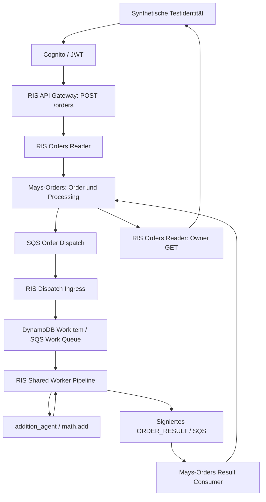

# RIS × Mays-Orders
## Technisches Integrations- und Abnahmedossier

**Stand:** 28. November 2026 · **Version:** 1.0 · **Status:** Technische Integration abgeschlossen (synthetische DEV2-Abnahme)

**Repository:** `maynowak/Mays-Recruiting-Intelligence-System`  
**Main-Commit:** `8b9a70604e94cc96124c132253c802f8b048825f`  
**Integrierter Mays-Orders-Quellstand:** `db4f9e79980443de1cd3d5b688a33c0cf0eb771f`  
**Umgebung:** RIS-DEV2, `eu-central-1`, Workspace `ris-dev2`  
**Dokumenttyp:** interne technische Abschlussdokumentation; keine Produktivfreigabe oder juristische Datenschutzbescheinigung.

## 1. Management Summary

Das Integrationsprojekt hat die durchgängige Verarbeitung eines Agentenauftrags zwischen RIS (Recruiting Intelligence System) und Mays-Orders technisch nachgewiesen. Ein authentifizierter synthetischer Addition-Auftrag wurde über die RIS Orders API angelegt, über den asynchronen Transport an den gemeinsamen Worker weitergeleitet, ausgeführt und über einen HMAC-geprüften Ergebnisvertrag an die Order-Verarbeitung zurückgegeben. Die Ergebnisdaten wurden persistiert und für den autorisierten Eigentümer wieder ausgelesen. Die `orderDescription` blieb unverändert. Das Ergebnis lautet **19 + 23 = 42**.

Die Abnahme umfasste außerdem die Konsolidierung der Originaltests beider Projekte, versionsgebundene Modul- und Artefaktprüfung, Fehlerkorrekturen im gemeinsamen Worker, kontrollierte Terraform-Operationen, Deaktivierung des historischen HTTP-ATS-Agenten und die anschließende Entfernung der temporären Testberechtigung. PR #17 wurde regulär in Main integriert. Der Merge ist auf GitHub verifiziert; PR- und Main-CI PASS wurden durch den ausführenden Betreiber bestätigt.

Die Integration ist ausdrücklich keine Abnahme eines neueren RC4-Kandidaten, keine erfolgreiche Live-Abnahme des internen ATS-/CV-/Job-Parsing-Verfahrens und keine Freigabe für echte personenbezogene Daten. Historische offene Canary-Artefakte wurden nicht durch den erfolgreichen Addition-Test nachträglich repariert.

| Abnahmegegenstand | Finaler Stand |
|---|---|
| Integrierter Modulstand | VERIFIED (`db4f9e7…`; reproduzierbarer Quell-/Test-Pin, nicht Main-HEAD) |
| OrderDescription und JSON-Transport | PASS |
| Addition Live E2E | PASS, genau ein POST |
| HMAC-Ergebnis und Owner-GET | PASS |
| Historischer HTTP-ATS-Agent | INACTIVE; keine gültige ATS-Testberechtigung bei der Abnahme |
| Temporäres Addition-Entitlement | Entfernt |
| Shared Infrastructure beim Cleanup | Unverändert; zehn Lambda-Code-Hashes bestätigt |
| Terraform State | Serial 79, Lineage unverändert |
| Git-Integration | PR #17 MERGED, Main `8b9a706` |
| Produktiv-Privacy / RC4 / interne ATS-Pipeline | Separate offene Freigaben |

### Finaler Abnahmestatus am RIS-Main-Stand `8b9a706`

```text
TECHNICAL_INTEGRATION=VERIFIED
ADDITION_LIVE_E2E=PASS
ATS_HTTP_AGENT=DISABLED
TEMPORARY_ENTITLEMENT_CLEANUP=COMPLETE
SHARED_INFRASTRUCTURE=UNCHANGED
STATE_SERIAL=79
MAIN_INTEGRATION=COMPLETE
MAIN_HEAD_AT_ACCEPTANCE=8b9a70604e94cc96124c132253c802f8b048825f
PR_17=MERGED
PR_CI=PASS
MAIN_CI=PASS
```

Die Kapitel 1–14 übernehmen die technische Begründung, Verträge und
zeitbezogenen Nachweise. Frühere `STOP`-/`BLOCKED`-Berichte bleiben historische
Gate-Snapshots und werden nicht umgeschrieben; der obige finale Status und
Kapitel 12 supersedieren deren frühere Freigabezustände. Die getestete
synthetische technische Abnahme ist keine Freigabe für reale personenbezogene
Daten; die noch offenen Privacy-Anforderungen sind in §6.1 und §13 abgegrenzt.

## 2. Ziel, Umfang und Verantwortungsgrenzen

Das Ziel war nicht der Aufbau eines neuen Bestellsystems, sondern die belastbare Integration des bestehenden Mays-Orders-Moduls in RIS. Auftragsanlage, Verarbeitung und Ergebnisübernahme sollten unter Verwendung der bestehenden Schnittstellen und Originaltests verifiziert werden. Das Projekt folgt dem Prinzip, dass Fehler an ihrer tatsächlichen Verantwortungsgrenze korrigiert werden, statt inkompatible Schnittstellen durch stillschweigende Adapter oder das Entfernen von Feldern zu kaschieren.

RIS verantwortet in diesem Ablauf die authentifizierte Agentenanforderung, Identitäts- und Berechtigungsprüfung, Dispatch-Ingress, WorkItem-Lifecycle und Agentenausführung. Mays-Orders stellt den Order-Lifecycle, die Order-Datenhaltung und den Ergebnis-Consumer des integrierten Moduls bereit. Der RIS Orders Reader ist der externe Zugang für die verwendete RIS-Testidentität; die separate Mays-Orders-API ist kein austauschbarer Zugang. Infrastruktur und Modul-Builder bilden den installationsbezogenen Vertrag zwischen beiden Projekten.

Nicht im Abnahmeumfang liegen produktive Abrechnung, ein belastbarer Kostenhöchstwert, Partner-Traffic, neue API-Funktionen, die interne ATS-Analyse und ein vollständiges RC4-Upgrade. Das Additionsbeispiel reduziert fachliche Abhängigkeiten und vermeidet externe ATS- oder KI-Aufrufe; es prüft den generischen Transport und Ausführungsweg, nicht die Qualität einer Recruiting-Analyse.

## 3. Architektur und Datenfluss



Das Diagramm ist eine logische Sicht der geprüften Verarbeitungskette und keine vollständige Terraform-Ressourcenkarte. Insbesondere sind persistierte WorkItems und Queue-Nachrichten unterschiedliche Objekte; ihre Korrelation ist Bestandteil des Integrationsnachweises.

### 3.1 Sequenz des vollständigen Order-Roundtrips

```mermaid
sequenceDiagram
    autonumber
    actor Owner as Synthetischer Owner
    participant Cognito as Cognito / JWT
    participant API as RIS Orders API + Orders Reader
    participant MO as Mays-Orders Order Handler
    participant DQ as Order-Dispatch-SQS
    participant Ingress as RIS Dispatch Ingress
    participant Profile as API-Profile / Entitlement
    participant WDB as WorkItem-DynamoDB
    participant WQ as RIS Work-Queue-SQS
    participant Worker as RIS Shared Worker / Agent
    participant RQ as Order-Result-SQS
    participant Consumer as Mays-Orders Result Consumer

    Owner->>Cognito: Authentifizieren; ID/Access-Token erhalten
    Owner->>API: POST /orders + Bearer JWT + OrderV1
    API->>API: JWT, iss/sub und Tenant-Kontext prüfen
    API->>MO: Create über RIS Orders Reader (RIS-owned Route)
    MO->>MO: Order persistieren; Work-/Correlation-IDs binden
    MO-->>Owner: 201 + Order-ID
    MO->>DQ: ORDER_DISPATCH mit OrderDescription/AgentOrder-Transport
    DQ->>Ingress: Dispatch-SQS-Nachricht
    Ingress->>Ingress: Envelope und Queue-Bindung validieren
    Ingress->>Profile: contextRef auflösen; ACTIVE-Status prüfen
    Profile-->>Ingress: verifizierter Owner-/Tenant-/Profile-Kontext
    Ingress->>Profile: Dispatch-Entitlement autorisieren
    Profile-->>Ingress: Agent-/Tenant-/Zeitfenster-Gate
    Ingress->>WDB: bedingtes WorkItem Put (Idempotenz)
    Ingress->>WQ: WorkItem-ID enqueuen
    WQ->>Worker: WorkItem zustellen
    Worker->>WDB: QUEUED claim / RUNNING persistieren
    Worker->>Worker: Registry/Eligibility; addition_agent.math.add
    Worker->>WDB: Ergebnis + COMPLETED mit Attempt-Fence persistieren
    Worker->>RQ: ORDER_RESULT + serviceSignature (HMAC-SHA256)
    RQ->>Consumer: signierte Result-Nachricht
    Consumer->>Consumer: HMAC und Envelope validieren
    Consumer->>MO: orderId/Correlation/WorkItem/Attempt abgleichen
    MO->>MO: processing-Ergebnis idempotent persistieren
    Owner->>API: GET /orders/{id} mit Bearer JWT
    API->>MO: Owner-bound Read
    MO-->>Owner: 200 + Order/Processing/Result
```

Die Sequenz beschreibt den für den Addition-Test nachgewiesenen Pfad. Der
Entitlement-Check ist ein Zugriffs-Gate, kein Billing- oder Einmalverbrauchs-
Mechanismus. Ein Result-Consumer-Erfolg ersetzt weder die Owner-Prüfung des
Readers noch eine Privacy-Freigabe.

### 3.2 Auftragsvertrag und öffentliche Projektion

`orderDescription` ist ein optionaler, opaker Textwert. Im Agentenauftrag kann er das serialisierte AgentOrder-Dokument enthalten. Die API darf diesen Inhalt nicht unbemerkt verwerfen oder verändern. Der lokale E2E-Test und die Live-Abnahme bestätigen die Gleichheit der Beschreibung entlang Create, Persistenz und Owner-GET.

Das strukturierte interne Feld `agentOrder` ist von der öffentlichen OrderV1-Projektion zu unterscheiden. Die Beschreibung selbst kann vom Client gesetzte Metadaten enthalten; „internes Feld nicht projiziert“ bedeutet daher nicht, dass gleichnamige clientseitige Werte niemals im Beschreibungstext vorkommen. Für Listen gilt eine reduzierte Projektion. Legacy-Datensätze ohne `orderDescription` besitzen einen eigenen gefilterten Projektionspfad. Maßgeblich bleibt der API-STANDARD im Repository.

### 3.3 Transport, Korrelation und Ergebnis

Der Auftrag wird asynchron über den bestehenden SQS-Transport weitergegeben. Die Dispatch-Komponente legt bzw. vermittelt das zugehörige WorkItem. Der Worker prüft Admission, Berechtigung und den registrierten Agenten und führt die fachliche Operation aus. Das Ergebnis wird als `ORDER_RESULT` mit HMAC abgesichert an den Consumer übergeben. Dieser verarbeitet das Ergebnis in die Order-Persistenz zurück. Der HMAC schützt die Integrität und Authentizität des Ergebnisvertrags im Rahmen der gemeinsamen Schlüsselverwaltung; er ersetzt weder JWT-Autorisierung noch Datenschutzprüfungen.

Request-ID, Envelope-`idempotencyKey`, Order-ID und WorkItem-ID haben unterschiedliche Rollen. Die Abnahme erlaubte genau einen logischen Auftrag und genau einen manuellen POST. RIS `POST /orders` implementiert keinen HTTP-`Idempotency-Key`; der Request-ID-Wert im Nachweis ist kein Beleg für HTTP-Idempotenz. Die vorhandene SQS-Wiederzustellungssemantik mit `maxReceiveCount=3` wurde ausdrücklich akzeptiert. Ein manueller Retry, Replay oder Redrive war nicht Teil der Freigabe.

Der RIS-Transportvertrag ist versioniert und strikt: `schemaVersion`,
`messageId`, `messageType`, `orderId`, `correlationId`, `idempotencyKey`,
`sender`, `recipient`, `identity`, `createdAt` sowie je Nachrichtentyp
`payload`/`execution`. Der Dispatch läuft **Mays-Orders → RIS**; Ergebnisarten
wie `ORDER_RESULT` laufen **RIS → Mays-Orders**. Identitätsangaben in der
Nachricht sind keine Autorität: `contextRef` wird serverseitig gegen den
aktiven API-Profile-Store aufgelöst und Claims müssen zum verifizierten Kontext
passen. Die Mays-Orders Result V1 Consumer-Teilmenge akzeptiert
`ORDER_RESULT`/`ORDER_FAILED`; die Signatur steht als SQS-Message-Attribut
`serviceSignature`, nicht als Secret im JSON.

```json
{
  "schemaVersion": "1",
  "messageId": "msg_<work-id>_order_result",
  "messageType": "ORDER_RESULT",
  "orderId": "ord_<alphanumeric>",
  "correlationId": "<request-correlation>",
  "idempotencyKey": "<transport-contract-idempotency-key>",
  "sender": {"system": "ris", "reference": "ris-runtime"},
  "recipient": {"system": "mays-orders"},
  "identity": {"contextRef": "<verified-profile-reference>"},
  "payload": {"sum": 42},
  "createdAt": "<RFC3339 timestamp>",
  "execution": {"workId": "<work-id>", "attempt": 1}
}
```

Der Sender bildet `serviceSignature` als HMAC-SHA256 über die UTF-8-Bytes von
`messageId + "\n" + body`, mit dem geheimen Service-Key als HMAC-Schlüssel.
Der Consumer prüft die Signatur in konstanter Zeit, bevor er die Nachricht
validiert oder eine Order verändert. Zusätzlich korreliert er Order-ID,
Correlation-ID und WorkItem-ID und verwirft fremde, stale oder bereits
finalisierte Ergebnisse; identische Duplikate sind idempotente No-ops.

### 3.4 Worker-Zustandsmodell

| Ausgangszustand | Zulässiges Verhalten |
|---|---|
| Keine Zeile | Bedingte Registrierung als RUNNING, danach Ausführung |
| QUEUED | Bedingter initialer Claim, danach Ausführung ohne Retry-Claim |
| FAILED | Bedingter Retry-Claim mit erwarteter Attempt-Nummer |
| RUNNING | Duplikatunterdrückung, kein unautorisierter Neustart |
| COMPLETED / DEAD_LETTER | Keine neue Ausführung; vorhandener terminaler Ergebnispfad |
| CANCELLED | Unterdrückung der Ausführung |
| Sonstige Zustände | Fail closed |

Terminale Writes bleiben an RUNNING und die Attempt-Nummer gebunden. Der historische Defekt `CLAIM_WITHOUT_EXECUTION` bestand darin, dass ein erfolgreiches QUEUED-Claim anschließend fälschlich durch den FAILED-Retry-Claim lief. Die minimale Korrektur trennt beide Zweige. Ein RED/GREEN-Test belegt den Fehler und die Korrektur; zusätzliche Tests prüfen Claim-Verlust, konkurrierende Retries und RUNNING-Duplikate. Ein bereits festsitzendes RUNNING-WorkItem wird durch diesen Fix nicht automatisch wiederhergestellt.

## 4. Versions- und Artefaktmanagement

Der integrierte Quellstand ist exakt `db4f9e79980443de1cd3d5b688a33c0cf0eb771f`. Der Unified Runner prüft die Herkunft der Mays-Quellen gegen den Builder-Pin und das generierte Manifest. Originaltests werden aus einem sauberen, exakt gepinnten Checkout ausgeführt. Der generierte Modulbaum ist Builder-eigen und darf nicht manuell verändert werden. Beim integrierten Pin wird der native, patchfreie Transportvertrag mit Result-Queue-Outputs und `additional_environment` verwendet.

Der für die erzeugte RIS-Modulversion und die integrierten Originaltests
verifizierte Stand ist `db4f9e79980443de1cd3d5b688a33c0cf0eb771f`. Er ist nicht
mit dem Mays-Orders-Main-HEAD oder einem RC4-Upgrade gleichzusetzen. Der Tag
`v0.6.0-rc.1` zeigt auf `5bc154e079b4d7ee9eedbbf5b45b1ecca5c35420`; diese
separate RC4-Kandidatenprüfung fand fehlende Transport-/Consumer-Module,
abweichende OrderDescription-Validierung und Terraform-Vertragslücken. Der
spätere OrderDescription-Kandidat `80a84ca2f146d5efaa31d41ba425359283333f21`
ist in RIS als `CANDIDATE_ONLY_NOT_INTEGRATED` verzeichnet. Er ist nicht der
integrierte Pin und kein bestandener Upgrade-Gate. Keiner dieser Kandidaten
wurde im Rahmen der hier dokumentierten Abnahme integriert oder produktiv
installiert.

Reproduzierbare Builds waren ein eigenständiges Arbeitspaket. Ursachen plattformabhängiger ZIP-Hashes waren unter anderem Zeilenenden, Kompressionsimplementierung und ZIP-Plattformmetadaten. Die Build-Tools kanonisieren Quellzeilenenden und ZIP-Metadaten und verwenden eine deterministische Speicherung. Zwei unabhängige Builds auf Windows und Ubuntu wurden verglichen. Reproduzierbarkeit bedeutet jedoch nicht, dass neu erzeugte Archive automatisch dieselben Bytes wie historisch deployte Artefakte besitzen.

Für den kontrollierten Worker-Apply wurden deshalb nur Worker und Dispatch-Ingress aktualisiert; historische Analysis-, Orders-Reader- und Parser-Artefakte wurden anhand ihrer bestehenden Identitäten und Dateipfade erhalten. Ein Hash ist einschließlich aller 64 Hexzeichen zu vergleichen. Die historischen und neu kanonisierten Artefakte dürfen nicht vertauscht werden.

| Relevante Artefaktidentität | SHA-256 |
|---|---|
| Worker / Dispatch (19H) | `507bc17db9f2ee0932e42de039a508ab3f01e3bb2b5510ea79f2e54f95b3a58d` |
| Erhaltenes Analysis-ZIP | `276b4e4420272167dd32c590d6dbabed4008724a7091e4d86504d5444fe26b10` |
| Erhaltenes Reader-ZIP | `610004f6eae3531e4c87236439e491bcbf0c102ea29161fef247c2713c81ae6b` |

## 5. Unified QA und Teststrategie

Der Orchestrator `scripts/unified_tests.py` bündelt vorhandene Tests, ohne sie aus Mays-Orders nach RIS zu kopieren oder ihre Semantik zu verändern. Gruppen laufen in getrennten Prozessen mit gruppenspezifischer Python-Umgebung. AWS-Profile und Zugangsdaten werden für die lokale QA isoliert; Live-Ausführung ist ein separates Gate. Die Referenzplattform Ubuntu war erforderlich, weil ursprüngliche Mays-Builder-/Installer-Tests POSIX-Pfade und Linux-Voraussetzungen verwenden.

| Profil | Gegenstand |
|---|---|
| RIS_NATIVE | RIS-eigene Regressionen |
| MAYS_MODULE | Originaltests der exakt gepinnten Mays-Version |
| MODULE_BUILD | Generierter Modulvertrag und backendfreie Terraform-Prüfung |
| XREPO_CONTRACT | Verträglichkeit zwischen den Repositories |
| XREPO_E2E | Synthetischer Roundtrip über die integrierten Komponenten |
| FULL | Konsolidierter aktueller Testlauf |
| UPGRADE_GATE | Separater Kandidaten- und Versionsvertrag |
| LIVE | Gesperrt im lokalen Orchestrator; separate Freigabe |

### 5.1 Nachgewiesene Referenzresultate (19F8)

Ubuntu-Run `45996079592`, Commit `fba2721`, Python 3.14.10, integrierter Mays-Pin:

| Testgruppe | Ergebnis |
|---|---|
| RIS Native | 3.291 bestanden, 133 skipped, 450 Subtests |
| Mays Lambda | 240 bestanden |
| Mays Builder | 100 bestanden + 6 Subtests |
| Mays Installer | 81 bestanden |
| Mays Seed | 28 bestanden |
| Mays Cognito Backup | 2 bestanden |
| XRepo Contract | 133 bestanden + 4 Subtests |
| XRepo E2E | 39 bestanden |
| RIS Builder Contract | 57 bestanden |
| Generated Module Artifact | 9 bestanden |
| Mays Original OrderDescription (separat) | 15 bestanden |

FULL: PASS ohne Fehler oder Collection Errors. Die Zahlen sind Gruppenresultate mit möglichen Überschneidungen und keine addierbare Zahl einzigartiger Tests. Die historischen 19F2-Windows-Fehler wurden nicht als PASS umgedeutet. Spätere QA- und Regressionsevidenz liegt in 19G2/19G4 und den weiteren Integrationsberichten. Die finale Git-CI ist statische Prüfung, nicht erneut die gesamte FULL-Suite.

## 6. Sicherheit, Berechtigungen und Privacy

Die Live-Anforderung verwendete eine vorhandene synthetische, bestätigte Cognito-Identität mit passendem aktivem Owner-/Tenant-Profil. Der RIS Orders Reader prüft den authentifizierten Owner anhand normalisiertem `iss` und `sub` (Owner-Key: SHA-256 von `iss + NUL + sub`) und liefert nur ownergebundene Orders. Der etablierte Human-Client unterstützt `USER_PASSWORD_AUTH`; der RIS JWT-Authorizer erwartet die dazu passende Token-Identität, Issuer und Audience. Zugangsdaten und Tokens gehören nicht in Berichte oder Git.

Der temporäre Foundation-Grant ist an Benutzer, Tenant, Agent und Gültigkeitszeitraum gebunden. Er ist weder ein technisch erzwungenes Einmal-Entitlement noch ein Preislimit. Die Beschränkung auf genau eine Order ist eine zusätzliche Ausführungsfreigabe. `validUntil` beendet die Autorisierung, löscht aber die Zeile nicht automatisch. Deshalb erfolgte nach der Live-Abnahme ein separater Terraform-Cleanup.

Der historische HTTP-ATS-Agent blieb deaktiviert; vor dem Addition-Test wurde das Fehlen eines gültigen ATS-Grants festgestellt. Der Addition-Katalog blieb ABSENT, weil der hier verwendete Addition-Weg dispatch-basiert ist. Eine Katalogangabe allein ersetzt keine effektive Ausführungsberechtigung.

### 6.1 Datenschutz: nachgewiesener Stand und Grenzen

Die technische Privacy-Prüfung in RIS-DEV2 erlaubt ausschließlich synthetische Testdaten. Der Bericht `RIS-DEV2-PRIVACY-RELEASE-GATE-02` dokumentiert eine vorbestehende fehlende Subject-Index-Verknüpfung (`gsi2pk/gsi2sk`) für die betrachteten Orders. Inspect, Export und Erase-Preview finden solche Zeilen nicht über diesen Index. In einem hypothetisch verknüpften In-Memory-Datensatz entfernt ANONYMIZE die Beschreibung und anonymisiert Kundendaten, lässt aber die interne `agentOrder`-Kopie einschließlich Eingabedaten bestehen. ERASE löscht dagegen die gesamte verknüpfte Zeile. Diese Befunde müssen vor echten personenbezogenen Daten geprüft und behoben werden.

Mays-Orders besitzt eigene Privacy-Funktionen und separate synthetische Live-Nachweise in einer isolierten Installation. Daraus folgt keine automatische Privacy-Freigabe für RIS-DEV2. Die produktive Verwaltung/Rotation des Privacy-Secrets ist ebenfalls separat zu klären. Der Owner-GET mit HTTP 200 ist live belegt; der Fremd-Owner-404-Nachweis stammt aus lokalen Tests, nicht aus einer zweiten Live-Identität. Keine juristische DSGVO-Konformitätsbescheinigung wird erteilt.

## 7. Kontrollierte Infrastrukturänderungen

Alle tatsächlichen Änderungen wurden über einzeln freigegebene gespeicherte Terraform-Pläne durchgeführt. Die geprüften Installationseingaben wurden vollständig wiederverwendet; fehlende Feature- oder Transportvariablen hätten ansonsten ungewollte Deletions und IAM-Änderungen erzeugen können. Ein früherer Plan mit 0 Add / 4 Change / 13 Destroy wurde verworfen und nicht angewendet.

| Phase | Genehmigte Wirkung | State-Serial |
|---|---|---|
| Worker-Apply 19H | 0 Add / 2 Change / 0 Destroy; Worker und Dispatch-Ingress | 75 → 76 |
| Addition-Grant / ATS-Deaktivierung | 1 Add / 1 Change / 0 Destroy | 76 → 77 |
| Grant-Zeitfenster erneuern | 0 Add / 1 Change / 0 Destroy; nur validFrom/validUntil | 77 → 78 |
| Entitlement-Cleanup | 0 Add / 0 Change / 1 Destroy; exakt eine Zeile | 78 → 79 |

Plan-Hashes der letzten beiden Operationen:

- Renewal: `5bba7cfce9b84e6bdd24d7ff6a7120907b78b3aeee78fec684ecbfa43589fd7f`
- Cleanup: `d4c14cfb45105b76e689aa81b65ef6b645ba802cc1c59f7fe3f4b647265ccb10`

State-Lineage blieb `a0bd361d-5cd1-a207-a8c0-e6888f0be082`. Letzte dokumentierte S3-Version: `69Mksseizux6JercRCm0BTdIVF5S5GeUF`. Diese Werte sind historische Nachweise, keine für weitere Operationen gültige Freigabe.

## 8. Finale Live-Abnahme

| Eigenschaft | Nachweis |
|---|---|
| Datum | 28.11.2026 |
| Methode | Ein authentifizierter POST an RIS `/orders` |
| Request-ID (kein HTTP-Idempotency-Key) | `ris-addition-live-f871426bc9444d4c98e4a9fb24dc925c` |
| Payload SHA-256 | `9db3d7ecf238bd5b3875ab3958ea9a4a9cb0173d07c04270a21caeea8790d907` |
| Agent / Capability | `addition_agent` / `math.add` |
| Input | 19, 23 (synthetisch) |
| Erwartetes / tatsächliches Ergebnis | 42 / 42 |
| HTTP Create | 201 |
| Order-ID | `ord_e83b1c15a32901a2622acc7f` |
| WorkItem | `work-dae09d78518965e1` |
| Dispatch | SENT |
| WorkItem | COMPLETED |
| Result Delivery | SENT |
| HMAC / Consumer | Ergebnisprüfung und Verarbeitung bestätigt |
| Order Processing | COMPLETED |
| Owner GET | HTTP 200 |
| OrderDescription | Unverändert |
| Zweiter POST / manueller Retry | Nein |
| Evidence-Commit | `7265411` |

Der erfolgreiche Test beweist die konkrete synthetische Verarbeitungskette. Er beweist nicht automatisch alle Agenten-Capabilities, Lastverhalten, externe ATS-Verfügbarkeit, Kostenobergrenzen oder Produktiv-SLAs.

## 9. Cleanup und Abschluss

Der temporäre Eintrag `addition-acceptance-b939b2ba7c27430b` in `ris-dev2-dev-entitlements` wurde über den Foundation-Mechanismus entfernt. Der gespeicherte Plan wurde genau einmal mit Exit-Code 0 ausgeführt. Die Guard-Ausnahme `SHARED_TEARDOWN_AUTHORIZED` war ausschließlich für diese Zeile gültig; sie war keine Erlaubnis zur Entfernung geteilter Tabellen oder anderer Infrastruktur.

Read-only-Vergleich danach: Entitlement fehlt in Datenhaltung und Terraform-State; ATS INACTIVE und Addition-Katalog ABSENT; Tabellenstruktur und zehn verwaltete Lambda-Code-Hashes unverändert. Order, WorkItem und Ergebnis bleiben erhalten. State-Serial 79. Checkpoint `bb7aa1b`.

Der geschützte lokale 19F2-Results-JSON-Diff blieb laut Betreiber unstaged und wurde nicht in den Merge übernommen. Die historische versionierte Datei ist weiterhin Bestandteil der vorhandenen QA-Dokumentation; das ist vom lokalen uncommitted Diff zu unterscheiden.

## 10. Fehlerchronik und Lessons Learned

| Beobachtung | Ursache / Entscheidung | Nachhaltige Regel |
|---|---|---|
| Canary bleibt RUNNING, kein Ergebnis | Initialer Claim fiel in Retry-Zweig | Zustandsübergänge explizit trennen; RED/GREEN-Regression |
| Windows FULL scheitert | Baseline-, Pfad-, Tool- und Umgebungsprobleme | Originaltests erhalten, Referenzplattform und Fehlerklassen angeben |
| RC4-Vertrag inkompatibel | Fehlender Transport/Consumer und Terraform-Vertrag | Versionsupgrade separat gate'n; keine Felder wegwerfen |
| ZIP-Hashes variieren | Zeilenenden und ZIP-Metadaten | Deterministische Builds; deployte Originalbytes bewusst erhalten |
| Terraform-Plan droht Ressourcen zu löschen | Unvollständige Installationsvariablen | Vollständige installationsbezogene Inputs; keine Teilkonfiguration als Vollplan |
| Grant läuft vor POST ab | Zeitfenster zu knapp für Freigaben | Restlaufzeit unmittelbar vor Ausführung prüfen |
| Preflight-Hash stimmt nicht | Reader-Hash in früherer Vorlage unvollständig | Hash aus Originalnachweisen übernehmen, nicht manuell verkürzen |
| Kein Bearer-Token | Fehlender autorisierter Auth-Kontext | Vor Live-Order bestehenden sicheren Authentisierungsweg bestätigen |
| API-Route scheinbar nicht vorhanden | Nur erste Seite von API Gateway gelesen | Alle Seiten abrufen; Routes, Integration, Authorizer und State abgleichen |
| Cleanup-Plan Exit 1 ohne Diagnose | Falsche TF_DATA_DIR-Ebene, fehlende Module | stdout/stderr und Exit-Code sichern; Arbeitsverzeichnis und Cache validieren |
| Merge-Status im Bericht historisch | Append-only Gate-Berichte enthalten frühere STOP-Zustände | Aktuellen Abschlussblock voranstellen; historische Nachweise nicht löschen |

Wesentliche Erkenntnis: Ein STOP bei unklarer Identität, Scope oder Diagnose ist korrektes Betriebsverhalten. Erst der Nachweis, dass der Blocker tatsächlich beseitigt wurde, darf ein neues Gate öffnen. Gleichzeitig sollten Preflight-Checks vollständig sein, damit vermeidbare Freigaberunden nicht wiederholt werden.

## 11. Betriebs- und Freigabe-Runbook (für künftige Änderungen)

Dieses Runbook ist eine Empfehlung aus dem Projekt und keine aktuelle Ausführungsfreigabe.

1. Versionspin, Branch/HEAD, Arbeitsverzeichnis und geschützte lokale Änderungen prüfen. Keine Vermischung von Kandidaten- und integriertem Teststand.
2. Geänderte Verträge und betroffene Originaltests identifizieren. Lokale Regression vor Live-Ausführung; keine echten AWS-Credentials in Testprozessen.
3. Zielkonto, Region, Workspace, Backend, State-Lineage/Serial/Version, vollständige Installationsinputs und Artefaktidentitäten verifizieren. Unerwarteten Drift nicht automatisch korrigieren.
4. Nur separat genehmigten Plan erzeugen. Vollständige redigierte stdout/stderr, Exit-Code, exakten Ressourcenscope und SHA-256 festhalten. Keine Wiederholung ohne neue Freigabe.
5. Vor Apply Hash und Scope erneut bestätigen. Gespeicherten Plan höchstens einmal anwenden. Read-only-Nachprüfung dokumentieren. Kein automatischer Rollback; dieser braucht einen eigenen geprüften Plan.
6. Für Live-Abnahme bestehenden autorisierten Authentisierungsweg, vollständiges API-Inventar, Grant-Zeitfenster und Request-Identität prüfen. Genau den genehmigten Request senden; keine manuellen Retries. Bestehende automatische Retry-Semantik ausdrücklich bewerten.
7. Order, WorkItem, Result, Delivery und öffentliche Owner-Projektion korrelieren. Unklare Ergebnisse stoppen, nicht durch neue Orders überdecken.
8. Temporäre Grants getrennt und eng begrenzt entfernen; erhaltene Nachweise und Infrastruktur read-only vergleichen.
9. Bericht und Auditlog je abgeschlossenem Schritt committen und pushen. Main-Kompatibilität, CI und Deployment-Trigger prüfen; Main-Merge ausschließlich separat autorisieren.

## 12. Git- und Release-Abnahme

PR #16 war bereits integriert. Der nachfolgende Abschluss wurde über PR #17 durchgeführt. Der PR umfasste laut GitHub 203 geänderte Dateien und endete mit Feature-HEAD `09a6a502d8b0b810d4e97aafb96241411f592a33`. GitHub bestätigt den regulären Merge-Commit `8b9a70604e94cc96124c132253c802f8b048825f` und den geschlossenen, gemergten PR.

Ground Zero CI prüft Terraform-Formatierung sowie backendfreie Modulvalidierung; es führt keinen AWS-Plan/Apply aus. Root-Validate kann in einem sauberen CI-Checkout ohne generiertes Mays-Modul übersprungen werden. Die Mays Compatibility QA ist für ausgewählte Feature-Pushes und manuellen Start konfiguriert. PR- und Main-CI PASS sowie das Ausbleiben von AWS-/Terraform-/Deployment-/Live-Order-Aktionen beim Merge wurden vom Betreiber bestätigt.

Der zentrale Statusbericht wurde in diesem Dokumentations-Branch um einen
eindeutigen Finalstatus ergänzt. Sein früherer STOP-Header und die zeitbezogenen
Gate-Snapshots bleiben als historische Evidenz erhalten und sind dem finalen
Status untergeordnet. PR-CI und Main-CI sind jeweils PASS; Main-Head bei
Abnahme ist `8b9a706`.

## 13. Offene Folgeaufgaben (außerhalb der technischen Abnahme)

- Produktiv-Privacy-Gate für RIS-Orders: Subject-Verknüpfung, vollständige Auskunft/Export/Erasure/Anonymisierung und Schlüsselverwaltung prüfen; keine realen Personendaten vor Freigabe.
- Interne ATS-Pipeline: Python Agent Runner → NodeParser → JavaScript Core (`parse.ats`, `parse.cv`, `parse.job`); separater Vertrag, QA und Live-Gate. Historischen HTTP-Agenten nicht automatisch reaktivieren.
- RC4-Upgrade: exakter Kandidat, Originaltests, generierter Modulvertrag und XRepo Contract/E2E separat nachweisen.
- Historische RUNNING/PENDING-Canaries und DLQ: bestehende Evidenz bewahren; keine automatische Recovery, Datenkorrektur oder Redrive ohne gesondertes Design und Freigabe.
- Produktive Abrechnung, Kostenbegrenzung, Partner-Traffic und Last-/Betriebs-SLAs sind eigenständige Freigaben.

## 14. Quellen und Nachweisindex

Die folgenden Originalberichte wurden aus dem RIS-Repository am Merge-Commit gelesen. Weitere Angaben stammen aus den Ausführungsberichten des Betreibers im Projektverlauf. Es wurde keine erneute AWS-Abfrage oder Testausführung durchgeführt. Die GitHub-Merge-Metadaten wurden separat verifiziert.

- [PR #17 und Merge](https://github.com/maynowak/Mays-Recruiting-Intelligence-System/pull/17)
- [Zentraler Integrationsstatus](https://github.com/maynowak/Mays-Recruiting-Intelligence-System/blob/8b9a706/docs/reports/RIS-MAYS-ORDERS-INTEGRATION-STATUS.md) — Live-Test, Grants, Plan-/Apply- und Cleanup-Nachweise, Main-Vorbereitung.
- [Unified Testsuite 19F2](https://github.com/maynowak/Mays-Recruiting-Intelligence-System/blob/8b9a706/docs/reports/RIS-MAYS-ORDERS-UNIFIED-TESTSUITE-19F2.md) — Originaltests, Isolation, historische Fehler.
- [Compatibility Resolution 19F4](https://github.com/maynowak/Mays-Recruiting-Intelligence-System/blob/8b9a706/docs/reports/RIS-MAYS-ORDERS-COMPATIBILITY-RESOLUTION-19F4.md) — RC4, Modulvertrag, Reproduzierbarkeit.
- [Worker Claim Fix 19C](https://github.com/maynowak/Mays-Recruiting-Intelligence-System/blob/8b9a706/docs/reports/RIS-DEV2-WORKER-CLAIM-FIX-19C.md) — Zustandsmatrix und RED/GREEN.
- [OrderDescription E2E Gate 19F8](https://github.com/maynowak/Mays-Recruiting-Intelligence-System/blob/8b9a706/docs/reports/RIS-DEV2-ORDER-DESCRIPTION-E2E-GATE-19F8.md) — Originaltests und Ubuntu-Referenzresultate.
- [Controlled Worker Apply 19H](https://github.com/maynowak/Mays-Recruiting-Intelligence-System/blob/8b9a706/docs/reports/RIS-DEV2-WORKER-CONTROLLED-APPLY-19H.md) — zwei Lambda-Updates, State und Artefakte.
- [Privacy Release Gate 02](https://github.com/maynowak/Mays-Recruiting-Intelligence-System/blob/8b9a706/docs/reports/RIS-DEV2-PRIVACY-RELEASE-GATE-02.md) — öffentliche Projektion, DSAR-Lücken, synthetische Freigabe.
- [Final Live Acceptance 20/21](https://github.com/maynowak/Mays-Recruiting-Intelligence-System/blob/8b9a706/docs/reports/RIS-DEV2-FINAL-LIVE-ACCEPTANCE-20-21.md) — historische ATS-Blocker, Entitlement- und Retry-Grenzen.
- [CI-Workflow](https://github.com/maynowak/Mays-Recruiting-Intelligence-System/blob/8b9a706/.github/workflows/ci-cd.yml) und [Compatibility QA](https://github.com/maynowak/Mays-Recruiting-Intelligence-System/blob/8b9a706/.github/workflows/mays-compatibility-qa.yml).

### Vertrags- und Implementierungsquellen

- RIS: [`agents/transport/order_transport.py`](../../agents/transport/order_transport.py), [`agents/transport/order_result_sender.py`](../../agents/transport/order_result_sender.py), [`agents/runtime/pipeline.py`](../../agents/runtime/pipeline.py), [`lambda/dispatch_ingress.py`](../../lambda/dispatch_ingress.py), [`lambda/orders_reader.py`](../../lambda/orders_reader.py), [`agents/orders/agent_order.py`](../../agents/orders/agent_order.py).
- Pin/Versionen: [`installer/mays-orders-builder.pinned.json`](../../installer/mays-orders-builder.pinned.json), [`installer/mays-orders-test-versions.json`](../../installer/mays-orders-test-versions.json).
- Mays-Orders source checkout at exact integrated commit: [`result_envelope.py`](https://github.com/maynowak/mays-order-aws/blob/db4f9e79980443de1cd3d5b688a33c0cf0eb771f/lambda/src/result_envelope.py), [`result_handler.py`](https://github.com/maynowak/mays-order-aws/blob/db4f9e79980443de1cd3d5b688a33c0cf0eb771f/lambda/src/result_handler.py), [`order_service.py`](https://github.com/maynowak/mays-order-aws/blob/db4f9e79980443de1cd3d5b688a33c0cf0eb771f/lambda/src/order_service.py).
- Verifizierte getrennte Kandidaten: [`RC4 tag 5bc154e`](https://github.com/maynowak/mays-order-aws/commit/5bc154e079b4d7ee9eedbbf5b45b1ecca5c35420), [`OrderDescription candidate 80a84ca`](https://github.com/maynowak/mays-order-aws/commit/80a84ca2f146d5efaa31d41ba425359283333f21).

**Finales Urteil:** `TECHNICAL_INTEGRATION=VERIFIED`, `ADDITION_LIVE_E2E=PASS`, `TEMPORARY_ENTITLEMENT_CLEANUP=COMPLETE`, `MAIN_MERGE=COMPLETE`. Der synthetische Integrationsauftrag ist abgeschlossen. Alle darüber hinausgehenden Freigaben bleiben getrennt.
